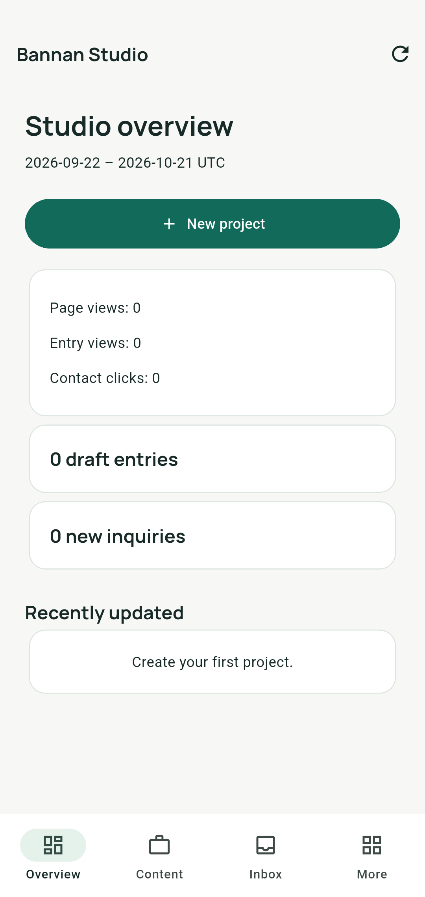
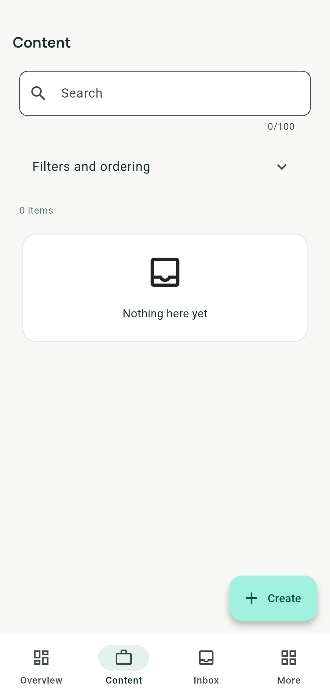
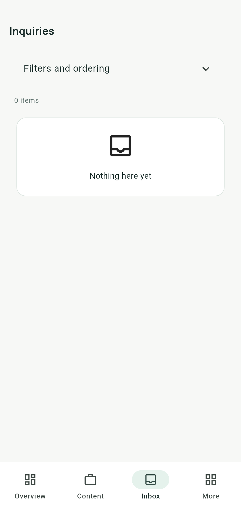

# Portfolio Platform

A self-hosted portfolio and small-team content platform: a Laravel API, a Flutter Android administration app, and a shared Dart API client. Built by Mahmoud Bannan / Brothers Tech as a practical example of backend and mobile development.

[](https://github.com/Mahmoudmnb/portfolio-platform/actions/workflows/backend.yml)
[](https://github.com/Mahmoudmnb/portfolio-platform/actions/workflows/dashboard.yml)
[](LICENSE)

Manage projects and products, team profiles, services, images, site settings and inquiries without editing website content in code. Publish drafts explicitly, process uploaded images through a queue, and review aggregate event counts.

## Preview

Screenshots show fictional development data. The dashboard is an Android application; the Jaspr website directory is currently reserved for integration.

| Overview | Content | Inbox |
| --- | --- | --- |
|  |  |  |

## What is included

- Versioned public and owner REST endpoints, with an [OpenAPI 3.1 contract](docs/openapi.yaml).
- One owner account, Sanctum tokens, explicit publication rules and validated content relationships.
- JPEG/PNG/WebP uploads, queued WebP processing, ready-only image selection and safe deletion rules.
- Private inquiries and aggregate page/entry/contact events; no unique-visitor tracking.
- Flutter management screens, secure credential storage, bounded image polling and server-aware sessions.
- MySQL/MariaDB constraints, concurrency tests, framework checks and separate backend/dashboard CI.

Products are portfolio entries with external links. Checkout, payments, public registration and multitenancy are outside the current scope. Signed distribution releases, physical-device acceptance and other unverified gates are documented in the [production review](docs/dashboard-production-review.md) and [finishing progress](docs/dashboard-finishing-progress.md). A CI badge reports GitHub's current state; historical completion reports describe only their recorded runs.

## Repository map

| Path | Purpose |
| --- | --- |
| `backend/` | Laravel API, database migrations, jobs, tests and container |
| `dashboard/` | Flutter Android owner application |
| `packages/portfolio_api/` | Framework-independent Dart client and contract models |
| `website/` | Reserved Jaspr website integration |
| `docs/` | Setup, architecture, API, deployment and verification evidence |

The Android dashboard calls the Laravel API; the planned website will use the same API. Laravel stores structured content in MySQL/MariaDB and images on a configured filesystem disk. A queue worker prepares images; a scheduler handles cleanup. On shared hosting, bounded cron-driven workers replace persistent development workers.

## Run your own instance

Use your own local backend and owner account. The author's live portfolio/API are operational services, not a shared administration sandbox or load-test target.

The repository currently targets PHP 8.5, Composer 2.9, MariaDB 11.8.9 (with a MySQL 8.4 compatibility lane), Flutter 3.47.7 / Dart 3.13.5 and JDK 17. Check the committed manifests/lockfiles and setup guides for exact requirements. PostgreSQL is an optional legacy data-transfer source, not the normal runtime database.

1. Clone the repository:

   ```sh
   git clone https://github.com/Mahmoudmnb/portfolio-platform.git
   cd portfolio-platform
   ```

2. Follow [backend local setup](docs/development.md) to configure a private `.env`, initialize a new development database, create an owner interactively and start the API, worker and scheduler. Docker Compose and host-native instructions are provided. No default owner password is shipped.

   With Docker Engine and Compose v2, start from the repository root:

   ```sh
   cp backend/.env.example backend/.env
   docker compose build
   docker compose up -d mysql mailpit
   docker compose run --rm app php artisan key:generate --show
   # Paste the generated key into APP_KEY in backend/.env before continuing.
   docker compose run --rm app php artisan migrate --force
   docker compose run --rm app php artisan db:seed --force
   docker compose run --rm app php artisan app:create-owner
   docker compose up -d app worker scheduler
   curl -f http://localhost:8000/api/v1/ready
   ```

   Use a fresh local database. Keep the generated key and owner password private. The API runs on port 8000 and Mailpit on [localhost:8025](http://localhost:8025). Compose creates the public media link during the image build; host-native setup requires `php artisan storage:link`.

3. Start the Android dashboard against that backend:

   ```sh
   cd dashboard
   flutter pub get --enforce-lockfile
   flutter run --dart-define=API_BASE_URL=http://10.0.2.2:8000/api/v1
   ```

   `10.0.2.2` reaches the host from the Android emulator. Physical devices need a reachable LAN URL; returned media URLs must also be reachable. See [dashboard setup](docs/dashboard-development.md). An omitted API_BASE_URL intentionally displays a configuration error.

## Documentation

- [Documentation index](docs/README.md)
- [Architecture](docs/architecture.md)
- [API integration guide](docs/api-integration.md) and [OpenAPI](docs/openapi.yaml)
- [Hostinger deployment](docs/hostinger-deployment.md) and [backup/recovery](docs/deployment.md)
- [PostgreSQL data transfer](docs/postgres-to-mysql-transfer.md)
- [Android release preparation](docs/dashboard-release-preparation.md)

## Contributing and support

Read [CONTRIBUTING.md](CONTRIBUTING.md) for local checks and pull requests. Use the [issue templates](https://github.com/Mahmoudmnb/portfolio-platform/issues/new/choose) for reproducible bugs and focused feature proposals. Participation follows the [Code of Conduct](CODE_OF_CONDUCT.md). Maintenance is best effort; there is no response-time guarantee.

Report vulnerabilities privately using [SECURITY.md](SECURITY.md), never in a public bug report. Do not include credentials, inquiry contents, database dumps or production logs in issues.

## License

Source code is available under the existing [MIT license](LICENSE), copyright 2026 Brothers Tech. Preserve third-party notices, including the bundled font licenses. See [THIRD_PARTY_NOTICES.md](THIRD_PARTY_NOTICES.md). Replace branding and personal/sample content when deploying your own instance; no endorsement is implied.
